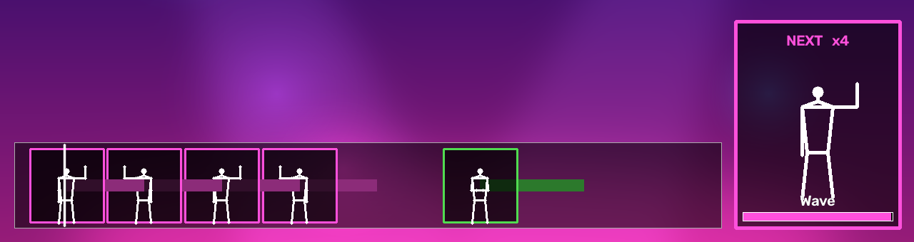

# IPCV - Just Dance - Group 38

Computer vision assignment: a Just Dance game for **2 players**, controlled only with the camera.
The game finds both players (YOLO pose), keeps track of who is who (shirt colour), grades their pose
against the move on screen, and adds fun head effects (big heads, the player name on the forehead, and a crown for the player who is ahead).



## Install

Tested with **Python 3.11** on Ubuntu 26.04, on a laptop without a GPU (the models run on the CPU with OpenVINO).

```
python3.11 -m venv .venv
.venv/bin/pip install torch torchvision --index-url https://download.pytorch.org/whl/cpu
.venv/bin/pip install -r requirements.txt
```

On Windows use `.venv\Scripts\pip` and `.venv\Scripts\python`. The second line installs the CPU version of
PyTorch (needed by Ultralytics); without it, pip takes the CUDA version, which is about 4 GB bigger. All versions are
in `requirements.txt`.

Models:
- the face model is in the repository: `face_tracking/face_detection_yunet_2023mar.onnx` (YuNet, OpenCV Zoo, 2023 March version);
- the YOLO models `yolo26n-pose.pt` (pose) and `yolo26n-seg.pt` (person segmentation for the stage) are in the
  ZIP of the submission. When they are missing, Ultralytics 8.4.189 downloads them the first time you start the game
  (from the Ultralytics GitHub releases, about 7 MB each).

The first start converts both YOLO models to OpenVINO (the `*_openvino_model/` folders, a few seconds); after that
the game starts faster.

## Run

```
python main.py                  # webcam 0
python main.py --camera 1       # another webcam
python main.py --video file.mp4 # a video file instead of the webcam
python main.py --debug          # debug drawings (boxes, FPS, state); n jumps to the next state
python main.py --windowed       # a window instead of full screen (q or ESC closes the game)
```

For testing and the report:

```
python main.py --measure                 # time every stage; results in measurements/<date_time>/
python main.py --measure --duration 120  # ... and stop after 120 s
python main.py --record                  # record the webcam and the game as videos in recordings/<date_time>/
python main.py --video recordings/<date_time>/webcam.mp4 --no-mirror   # play a recording into the game again
python -m unittest discover -s tests     # run the tests
```

`q` or `ESC` closes the game. That is only a safety exit: the game itself is played with gestures.

## How to play

1. **Song selection:** raise your **left hand** for the previous song and your **right hand** for the next
   song (hold it for 0.3 s, then lower it again). You hear a preview of the song. Raise **both hands**
   for 0.5 s to choose it.
2. **Registration:** stand in front of the camera, both players. Each player gets a colour and the label
   "Player 1" / "Player 2" on the forehead. Wear different coloured shirts, so the game does not mix you up.
3. **Raise both hands** (wrists above your nose) and hold them for 0.5 s. The bar above your head fills up.
   When both players are ready, the countdown starts.
4. **Playing:** the coming moves slide to the hit line at the bottom; be in the pose when it reaches the line,
   and copy the pose on the **NOW** card. Between moves the card already shows the **NEXT** move. Each move gives
   points once: Perfect, Good, OK or Miss, shown next to your score (your score is on your side of the bar).
   Gold moves count double. The player who is ahead wears a gold crown. If you walk out of the image, the game
   warns you and the song keeps going.
   **Animated moves** (magenta): the figure on the card moves, follow it step by step. Every correct step in a row
   makes your chain longer and gives extra points ("Chain x3").
   **Bonus star:** now and then a gold star floats across the screen at hand height. The first player who touches
   it with a hand gets **+100** points.
5. **Results:** the scores and the winner. Raise both hands (or wait 20 s) to go back to the song selection.

## Make an executable

You can pack the game into one folder with a program, so others can play without installing Python.

1. Make a **separate** Python environment with the **CPU version** of PyTorch. The normal PyTorch is the CUDA
   version, which adds about 4 GB of NVIDIA libraries that the game does not use (it runs YOLO with OpenVINO).
   ```
   python -m venv build-env
   build-env/bin/pip install torch torchvision --index-url https://download.pytorch.org/whl/cpu
   build-env/bin/pip install -r requirements.txt pyinstaller
   ```
   On Windows use `build-env\Scripts\pip` and `build-env\Scripts\python`.
2. Build (about 2 minutes):
   ```
   build-env/bin/python -m PyInstaller just_dance.spec --noconfirm
   ```
3. The game is `dist/JustDance/JustDance` (Windows: `dist\JustDance\JustDance.exe`). It takes the same options
   as `main.py` (`--debug`, `--windowed`, `--camera 1`, ...). Share the **whole** `dist/JustDance` folder (about 1.5 GB).

PyInstaller makes a program for the system you build on: build on Windows for Windows players. The recipe
(`just_dance.spec`) packs the YOLO model, its OpenVINO version, the face model and all songs (`.json` + `.ogg`).

## Project structure

| Folder / file | What it does |
|---|---|
| `main.py` | Reads the command line arguments and starts the game |
| `config.py` | All settings: paths, hold time, countdown time, head enlargement, ... |
| `camera.py` | Webcam / video input (mirrored, always the newest image) and the FPS counter |
| `game_logic/` | `game.py` runs the loop; `states/` has one file per game state; `song.py` the music and moves; `pose_grading.py` the score of a pose |
| `pose_tracking/` | YOLO pose estimation: the keypoints of every person |
| `identity_tracking/` | Which person is Player 1 and which is Player 2 (shirt colour + position) |
| `face_tracking/` | Finds the faces; big heads, the crown and the player label |
| `scene/` | Draws the screens: title, scores, move cards, song selection, registration, results and the bonus star |
| `background/` | The Just Dance stage instead of the room: finds the players (person segmentation) and draws the stage |
| `choreography/` | `poses.json` (all poses), one `.json` per song (the moves on the beats) and the music (`.ogg`). Every song `.json` here shows up in the song selection |
| `tests/` | Unit tests (`python -m unittest discover -s tests`) and `eval_identity.py`, the identity-tracking evaluation with its results |
| `docs/` | Documentation per part of the game (below); `figures/` has the system overview and a screenshot |
| `tools/` | `make_zip.sh` makes the ZIP of the submission |
| `requirements.txt` | The Python packages and their versions |
| `just_dance.spec` | The PyInstaller recipe for the executable |

## Documentation

| Document | About |
|---|---|
| [docs/game_structure.md](docs/game_structure.md) | The game states, the files, the song format, scoring |
| [docs/scene.md](docs/scene.md) | The `scene/` folder: which file draws which part of the screen |
| [docs/face_tracking.md](docs/face_tracking.md) | Face detection, big heads, the crown and the player label |
| [docs/identity_tracking.md](docs/identity_tracking.md) | How players are recognised by their shirt colour |
| [docs/background_and_star.md](docs/background_and_star.md) | The stage behind the players and the bonus star |
| [docs/animated_moves.md](docs/animated_moves.md) | Animated moves: a movement to follow, the chain bonus and the motion check |
| [docs/measurements.md](docs/measurements.md) | Measuring the frame rate and the time of every stage (`--measure`) |
| [docs/demo_video.md](docs/demo_video.md) | Recording the demo video (`--record`) and what the 55 s of Rasputin show |
