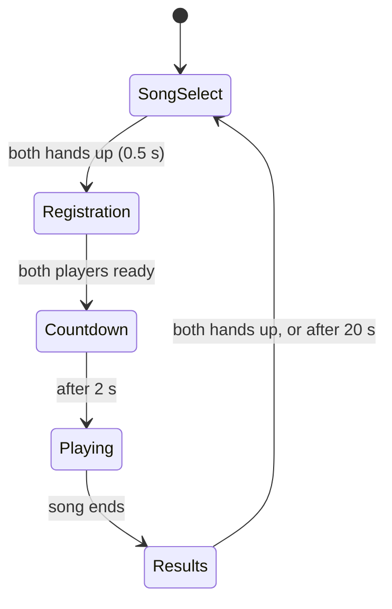

# Game structure

How the game is built: the states, the files, the song format and the scoring. For the drawing see
[scene.md](scene.md), for the head effects [face_tracking.md](face_tracking.md), for who is who
[identity_tracking.md](identity_tracking.md).

## The states

The game is always for **2 players** and is controlled with **gestures only**. The `q` / `ESC` key only closes the
window (a safety exit).



| State | What the players see | Actions | How to leave |
|---|---|---|---|
| **Song selection** | The selected song in a card (title, length, tempo, moves / duets / gold moves), with a music preview from 30% of the song | One hand up 0.3 s: previous / next song (lower the hand before the next step). Both hands up 0.5 s: choose | Choose → Registration |
| **Registration** | "Player 1" / "Player 2" in their colour, a progress bar or "READY" above each head | Both hands up 0.5 s: ready. A player who leaves the image is not ready any more | Both ready → Countdown |
| **Countdown** | "3, 2, 1, Dance!" and the timeline: the first move already slides in | none | After 2 s → Playing (music starts) |
| **Playing** | The timeline, the NOW card, the score bar, the ratings, the bonus star, "Chain x*n*", the duet bonus and a warning when a player is lost | Dance poses, duets, animated moves, grabbing the star | Song ends → Results |
| **Results** | The scores and the winner (or "Draw!") | Both hands up 0.5 s, from 3 s on | Play again or 20 s → Song selection |

All times are in seconds, not frames, so the game works the same on a slow and a fast laptop. They are in
`config.py` (`HOLD_TIME`, `BROWSE_HOLD_TIME`, `COUNTDOWN_TIME`, `RESULTS_MIN_TIME`, `RESULTS_MAX_TIME`).

- "Hands up" means the wrists are above the nose. "Left" and "right" come from the side of the nose where the
  wrist is (YOLO's left/right names are swapped in the mirrored image).
- Registration starts with `tracker.reset()`: old players and scores are removed. When the two players wear similar
  colours, the game shows "Please wear different colours".
- A registered player who is not seen for 0.5 s (`LOST_TIME`) is **lost**: "Player 2 lost - step back in!". The
  song keeps going; a lost player gets no points until found again. The 0.5 s keeps the warning from flickering.
- In **every** state the game draws the stage, the big heads, the player labels, the crown for the leader and the
  glow in the player colours at the screen edges.

## The files

```
main.py                     # reads the command line, starts the game
config.py                   # all settings and paths
camera.py                   # webcam / video input in its own thread (always the newest image)
game_logic/
    game.py                 # the Game class: runs the loop, owns the shared parts, switches states
    states/                 # one file per state; common.py: the State base class and the hold gesture
    song.py                 # reads a song file; the music, the song clock, the current and next move
    pose_grading.py         # the score 0-100 of one pose (joint angles)
    motion.py               # motion per player and the direction check of animated moves
    bonus_star.py           # the bonus star: when it comes, where it floats, who grabs it
    measurements.py         # --measure: the time of every stage
    recorder.py             # --record: the webcam and the game as videos
pose_tracking/              # YOLO pose: the keypoints of every person (Task 2)
identity_tracking/          # who is Player 1 and who is Player 2 (Task 3)
face_tracking/              # faces, big heads, crown, player labels (Task 1)
background/                 # the stage instead of the room: person segmentation + the stage (Task 5)
scene/                      # draws the screens (Task 5)
choreography/               # poses.json and one .json + .ogg per song
```

The main rule: **the states decide, the scene draws.** A state never draws pixels itself, and the `scene/` files
contain no game rules.

One frame in `Game.step()`: read the camera → face detection, pose estimation and segmentation at the same time
(three threads) → identity tracking → `state.update()` (the game rules) → the stage and the head effects →
`state.draw()` → show.

## Song files

Every `.json` in `choreography/` (except `poses.json`) is a song in the song selection, sorted by title.
`config.SONG_PATH` (Rasputin) is selected first. The poses are only defined in `poses.json`.

```json
{
    "title": "Rasputin",
    "audio": "rasputin.ogg",
    "bpm": 127,
    "move_bpm": 381,
    "offset": 0.0,
    "moves": [
        { "beat": 8,  "pose": "wave_right", "beats": 4 },
        { "beat": 16, "pose": "raise_linked_hands", "beats": 4 },
        { "beat": 24, "poses": ["conductor_right", "conductor_left", "conductor_right", "conductor_left"],
          "name": "Conductor" },
        { "beat": 60, "pose": "pencil", "gold": true }
    ]
}
```

`raise_linked_hands` is a duet pose; the last line is a made-up example of a gold move.

| Field | Meaning |
|---|---|
| `audio` | The music file, in the same folder (`.ogg`: about 8x smaller than `.wav`) |
| `bpm` | Tempo of the music (the beat pulse, the song selection) |
| `move_bpm` | Optional tempo of the **moves**: higher = shorter moves that come more often. Use a multiple of `bpm` to stay on the beat. Default: `bpm` |
| `offset` | Seconds of music before beat 0 |
| `beat` | The beat where the player must **be in** the pose |
| `pose` | A pose from `poses.json`. A duet pose (with `keypoints_2` and `interaction` in `poses.json`) gives each player their own pose |
| `beats` | How long the pose is held. Default: 2 |
| `poses`, `name`, `step_beats` | Instead of `pose`: an **animated move**, see [animated_moves.md](animated_moves.md) |
| `gold` | `true` = double points |

Beat to seconds: `offset + beat * 60 / move_bpm`. When the music is longer than the moves, the moves start again.
The song clock comes from the music player, so the moves always stay in sync with the music. Without a music file
a normal timer is used.

The file is **checked when it is loaded**: an unknown pose or overlapping moves stop the game at start-up with a
clear message (`rasputin.json move 7: pose "pencl" not found`), never in the middle of a song.

## Scoring

- Every frame of a move (from its start to 0.3 s after its end, `GRADE_GRACE`) is graded with `PoseGrader`: the
  joint angles of the player are compared with those of the pose, and the mean error *e* (degrees) gives
  `score = 100 * exp(-(e / 30) ^ 3)`. Angles do not change with body size or distance to the camera.
- Before grading, left and right are swapped (`MIRROR_SWAP` in `states/playing.py`), because the camera image is
  mirrored.
- The points of a move are the **70th percentile** of its frame scores (`SCORE_PERCENTILE`): the pose must be held,
  one lucky frame is not enough. Gold moves count double.
- Rating: **Perfect** (≥ 85), **Good** (≥ 65), **OK** (≥ 40), **Miss** (< 40), shown next to the score bar.
- **Duet:** both players score at least 50 and the interaction in `poses.json` is met (for example hands close
  together): +25% for both.
- **Animated moves:** a chain bonus for correct steps in a row, see [animated_moves.md](animated_moves.md).
- **Bonus star:** +100 for the first hand that touches it, see [background_and_star.md](background_and_star.md).

Points are given once per move, so a faster laptop does not give more points.
